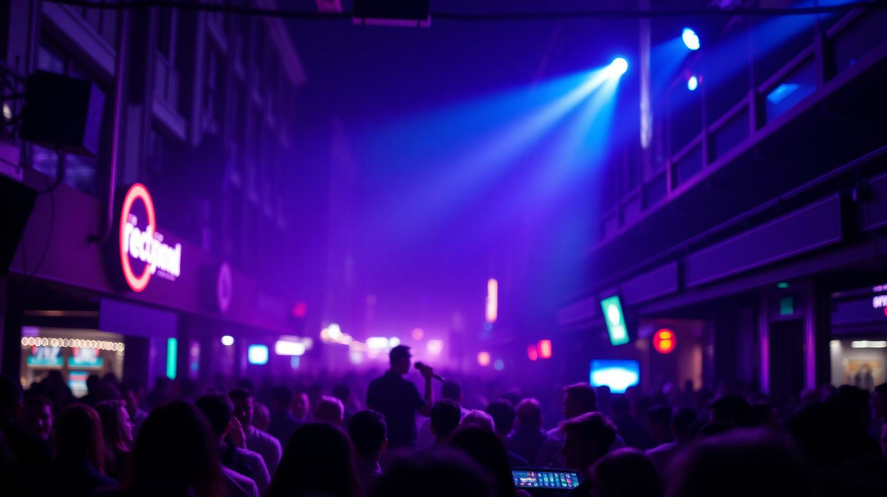

# 🎸 Palco Conectado

**Conectando talentos a grandes palcos.**

> O marketplace definitivo para bandas, músicos e estabelecimentos criarem experiências inesquecíveis.



---

## 🚀 Sobre o Projeto

**Palco Conectado** é uma plataforma moderna que revoluciona a forma como shows são negociados. Removemos a fricção entre artistas talentosos e estabelecimentos que buscam música ao vivo de qualidade.

Com uma interface inspirada nos melhores marketplaces (como iFood e Airbnb), oferecemos uma experiência fluida, transparente e profissional para todos os envolvidos.

### ✨ Para Bandas e Músicos
*   **Visibilidade Profissional**: Crie um perfil incrível com vídeos, faixas, agenda e rider técnico.
*   **Encontre Gigs**: Busque bares, restaurantes e casas de show que combinam com seu estilo e cache.
*   **Negociação Direta**: Envie propostas, negocie valores e feche contratos diretamente na plataforma.
*   **Gestão de Agenda**: Mantenha suas datas organizadas e evite conflitos.

### 🏢 Para Estabelecimentos
*   **Curadoria Simplificada**: Filtre artistas por estilo, avaliação, preço e disponibilidade.
*   **Contrate com Segurança**: Veja avaliações reais de outros contratantes.
*   **Vagas Abertas**: Publique oportunidades e receba propostas apenas de artistas qualificados.
*   **Calendário Integrado**: Gerencie sua programação musical de ponta a ponta.

---

## 🛠️ Tecnologias de Ponta

Este projeto foi construído com o que há de mais moderno no desenvolvimento web, garantindo performance, SEO e escalabilidade.

*   **⚡ Next.js 14 (App Router)**: Framework React full-stack para máxima performance e SEO.
*   **🎨 Tailwind CSS + Shadcn/ui**: Design system moderno, responsivo e acessível.
*   **💎 TypeScript**: Código robusto e tipado para manutenibilidade a longo prazo.
*   **🔒 Auth Context Avançado**: Sistema de autenticação multi-perfil (alterne entre Banda, Músico e Contratante com um clique).
*   **📦 Lucide React**: Ícones vetoriais modernos e leves.

---

## 📸 Funcionalidades Destaque

### 1. Sistema Multi-Perfil
Uma única conta, múltiplas personas. Você toca em uma banda de Rock na sexta, faz voz e violão no sábado e contrata bandas para seu bar no domingo? **Nós suportamos tudo isso sem precisar deslogar.**

### 2. Matchmaking Inteligente
Não perca tempo. Nosso sistema sugere artistas que se encaixam no perfil do seu estabelecimento e vice-versa, baseado em localização, estilo musical e faixa de preço.

### 3. Wizard de Onboarding
Comece com o pé direito. Nosso fluxo de cadastro guiado ajuda você a montar um perfil completo e atraente em minutos.

---

## 🚀 Como Rodar Localmente

Clone o projeto e instale as dependências:

```bash
# Instalar dependências
npm install

# Rodar servidor de desenvolvimento
npm run dev
```

Acesse [http://localhost:3000](http://localhost:3000) e comece o show! 🤘

---

**Palco Conectado © 2026** — *Feito para quem vive de música.*
